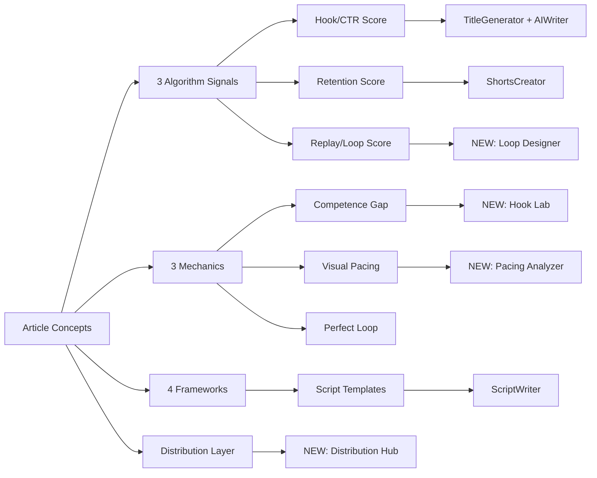

# Virality Integration Guide

Translating Chris Girbu's "8 billion views" framework into ViewMagnet features.

> **Source**: [@chrisgirbu on X, May 15 2026](https://x.com/chrisgirbu) — "I've generated 8 billion views. Here's how to go viral."

---

## Core Thesis

Virality is **engineered, not random**. The algorithm rewards three watch-behavior signals:

1. **Start** — does the viewer begin watching?
2. **Keep** — do they stay?
3. **Repeat** — do they watch again?

Quality is a prerequisite, but the mechanics that move these three numbers are what separate 10K-view content from 10M-view content.

---

## Conceptual Map



---

## Part 1: The 3 Algorithm Signals → Refactor Scoring Model

Today, `VideoAnalyzer` returns a single composite `prediction_score`. The article makes a strong case that creators need to know **which** signal is failing.

### Changes

**File**: `src/api/analyze.py`, `src/features/llm_analyzer.py`

Add three sub-scores to `AnalyzeResponse`:

```python
class AlgorithmSignals(BaseModel):
    start_score: float       # CTR drivers: thumbnail, title, hook
    retention_score: float   # Pacing, density, dead-air
    replay_score: float      # Loop quality, ending-to-hook bleed
    composite: float         # Weighted product
    weakest_signal: str      # "start" | "keep" | "repeat"
    diagnosis: str           # LLM-generated, e.g. "Your loop is the bottleneck"
```

**Frontend**: Update `VideoAnalyzer.tsx` to show a 3-bar diagnostic so users immediately see which signal to fix.

---

## Part 2: The 3 Mechanics → New + Enhanced Features

### 2A. Competence Gap → New "Hook Lab"

> "The hook's only job is to create a gap that can only be closed by watching the rest of the clip."

**New file**: `src/features/hook_lab.py`

#### Hook Type Classifier

| Type | Pattern | Example | Strength |
|------|---------|---------|----------|
| Summary | "Here are N tips to..." | "3 tips to grow Instagram" | Weak |
| Mistake Callout | "You've been doing X wrong" | "You've been posting reels wrong" | Strong |
| Belief Destruction | "X is a lie / X doesn't work" | "Posting times don't matter — here's what does" | Strong |
| Authority Anchor | Credentials + contrarian | "I've generated 8B views, here's why most creators fail" | Strong |
| Stake Reversal | Inverts expectation | "Stop chasing trends. Do this instead." | Strong |
| Specificity Hook | Named system / hidden asset | "The [SYSTEM NAME] framework, blurred for now..." | Strong (lead-gen) |

#### API Sketch

```python
class HookLab:
    def score_gap(self, hook: str) -> GapAnalysis:
        """Score 0-100 across: belief_challenge, mistake_callout,
        urgency, specificity. Returns weakest dimension."""

    def rewrite_for_gap(self, weak_hook: str, video_topic: str,
                        target_type: HookType) -> list[str]:
        """Returns 5 gap-engineered alternatives via llm_client."""

    def detect_summary_pattern(self, hook: str) -> bool:
        """Flags 'X tips to Y' style summary hooks."""
```

#### Frontend

Add a "Hook Lab" tab inside `TitleGenerator.tsx`:

- Paste a hook → see the 4 gap dimensions scored
- Auto-detect "summary" hooks and suggest rewrites
- Show 5 alternatives generated using each strong pattern

---

### 2B. Visual Pacing → Enhance Shorts Creator

> "A 10M-view video has zero dead air. Not reduced dead air. Zero. Every 3 to 5 seconds there's a visual reset."

**File**: `src/features/shorts_creator.py` — add a `PacingAnalyzer` class.

#### Detection Strategy

| Signal | Method |
|--------|--------|
| Cut frequency | FFmpeg scene detection: `-vf select='gt(scene,0.3)'` |
| Dead-air spans | Audio RMS analysis — flag silent regions > 1.5s |
| Visual reset cadence | Time between scene changes |
| Progressive disclosure | Detect text overlays appearing item-by-item |

#### API Sketch

```python
class PacingReport(BaseModel):
    avg_cut_interval_sec: float
    cuts_per_minute: int
    dead_air_segments: list[tuple[float, float]]  # (start, end)
    pacing_grade: str  # "A" if 3-5s cadence, "F" if > 8s gaps
    recommendations: list[str]  # "Add cut at 0:14", "Trim 0:32-0:38"

class PacingAnalyzer:
    def analyze(self, video_path: str) -> PacingReport: ...
    def suggest_cuts(self, video_path: str) -> list[CutSuggestion]: ...
```

#### Frontend

Add a "Pacing Score" panel to `ShortsCreator.tsx` showing:

- Visual timeline with red bars for dead air
- Pacing grade (A-F) prominent
- Auto-suggested cut points the user can apply with one click

---

### 2C. Perfect Loop → New "Loop Designer"

> "The final sentence has to bleed back into the first sentence of the hook. The viewer finishes and the brain doesn't register a stopping point."

This is the most under-served idea in your current product. Build it as a flagship feature.

**New file**: `src/features/loop_designer.py`

#### Detection: Loop Quality Score

```python
class LoopAnalysis(BaseModel):
    loop_score: float           # 0-100
    semantic_overlap: float     # cosine sim of last sentence vs first
    visual_continuity: float    # last frame vs first frame similarity
    audio_continuity: float     # ending audio energy vs hook audio
    has_stop_signal: bool       # detects "thanks for watching", "subscribe"
    recommendations: list[str]
```

#### Generation: Loop Engineering

```python
class LoopDesigner:
    def analyze_loop(self, transcript: str, video_path: str) -> LoopAnalysis: ...

    def generate_loop_endings(self, hook: str, script: str) -> list[str]:
        """Generate 3-5 ending sentences that semantically bleed back
        into the hook. Uses llm_client with prompt:
        'Write an ending that creates a thought-loop back to: {hook}'"""

    def detect_stop_signals(self, transcript: str) -> list[str]:
        """Flag phrases that explicitly end the video
        ('thanks for watching', 'see you next time', etc.)"""
```

#### Frontend

New dashboard route: `/dashboard/loop-designer`

- Input: transcript + hook
- Output: loop score, ending alternatives that loop back
- Visual diff showing semantic overlap between ending and hook

---

## Part 3: The 4 Frameworks → Script Writer Templates

The article describes 4 internal frameworks. Add each as a structured template in `src/features/script_writer.py`.

### Framework Definitions

#### 1. Authority Myth-Buster
**Goal**: Build trust fast with new audiences

```
[CONTRARIAN HOOK] - Challenge a widely held belief
[AUTHORITY ANCHOR] - "I've done X / managed Y / generated Z"
[3-PART SOLUTION] - Three concrete points
[IDEOLOGICAL CTA] - Belief-based call to action
```

#### 2. Delta Shift (highest save rate)
**Goal**: Drive saves and shares

```
[BASELINE] - "Here's what the average person does"
[DELTA] - "Here's what the top 1% does instead"
[SINGLE TAKEAWAY] - One immediately actionable item
```

#### 3. Progressive Debunking / Iceberg (max watch time)
**Goal**: Maximize retention

```
[POLARIZING TOPIC] - Pick a hot debate
[DISMISS SURFACE] - "Everyone obsesses over X. That's noise."
[REVEAL LAYER 1] - "The real mechanic is Y"
[REVEAL LAYER 2] - "But underneath that is Z"
[FINAL REVELATION] - The deepest truth
```

#### 4. Lead Magnet (lead generation)
**Goal**: Fill auto-DM funnels

```
[NAMED SYSTEM PROMISE] - "The [YOUR-SYSTEM-NAME] framework I use..."
[BLURRED ASSET] - Show the deliverable, blurred on screen
[RAPID BREAKDOWN] - Quick parts overview
[KEYWORD CTA] - "Comment [YOUR-SYSTEM-NAME] and I'll send it"
```

> Internal slug ``hype_heit`` is kept for URL / DB stability; the
> user-facing name is "Lead Magnet Framework". The creator invents
> the actual system name (it should be distinctive so the DM keyword
> doesn't collide with other comments).

### Implementation

```python
class ScriptFramework(str, Enum):
    AUTHORITY_MYTH_BUSTER = "authority_myth_buster"
    DELTA_SHIFT = "delta_shift"
    PROGRESSIVE_DEBUNKING = "progressive_debunking"
    HYPE_HEIT = "hype_heit"  # display name: "Lead Magnet Framework"

class FrameworkScript(BaseModel):
    framework: ScriptFramework
    sections: list[ScriptSection]
    estimated_duration_sec: int
    primary_goal: str  # "trust" | "saves" | "retention" | "leads"

class ScriptWriter:
    def generate_with_framework(
        self,
        topic: str,
        framework: ScriptFramework,
        target_duration: int = 60,
    ) -> FrameworkScript: ...
```

### Frontend

In `ScriptWriter.tsx`:

- Add a framework selector card with the 4 options + their goals
- Show a preview of the structure before generating
- Tag the resulting script with the framework name so users can A/B test

---

## Part 4: Distribution Layer → New "Distribution Hub"

> "We run over 40 pages across Instagram, TikTok, and YouTube for a single creator at full scale."

This is a longer-term feature but a clear differentiator. Build incrementally.

### Phase 1: Multi-Account Tracking

**New file**: `src/features/distribution_hub.py`

```python
class ConnectedAccount(Base):
    __tablename__ = "connected_accounts"
    id: Mapped[int] = mapped_column(primary_key=True)
    user_id: Mapped[int]
    platform: Mapped[str]  # youtube | tiktok | instagram
    account_type: Mapped[str]  # main | secondary | fan | clipping
    handle: Mapped[str]
    oauth_token: Mapped[Optional[str]]
```

### Phase 2: Cross-Platform Publishing

Extend existing `src/features/social_publisher.py` to:

- Push the same Short to multiple connected accounts simultaneously
- Vary captions/hashtags per account using llm_client
- Track which account variant performed best

### Phase 3: Clipping Workflow

A "Clip & Distribute" button in `ShortsCreator.tsx` that:

1. Identifies 3-5 highlights from a long-form video
2. Generates platform-specific edits (vertical for TikTok/Reels, horizontal for YouTube)
3. Schedules across all connected secondary/fan/clipping accounts
4. Aggregates analytics back into one dashboard

---

## Build Priority

Recommended ship order based on impact-to-effort ratio:

| # | Feature | Effort | Impact | Notes |
|---|---------|--------|--------|-------|
| 1 | Hook Lab (gap classifier + rewriter) | S | **High** | Pure LLM, no new infra |
| 2 | 4 Framework templates in ScriptWriter | S | **High** | Prompt engineering only |
| 3 | 3-Signal scoring refactor | M | **High** | Touches main analyzer |
| 4 | Loop Designer (analysis + generation) | M | **High** | Differentiator — nobody else has this |
| 5 | Pacing Analyzer in ShortsCreator | M | Medium | Requires FFmpeg work |
| 6 | Distribution Hub Phase 1 | L | Medium | OAuth heavy |
| 7 | Distribution Hub Phase 2-3 | XL | High | Long-tail moat |

Items 1-4 can ship in a single sprint and would land all of the article's "10M-view mechanics" inside ViewMagnet.

---

## File Change Summary

| File | Action | Purpose |
|------|--------|---------|
| `src/features/hook_lab.py` | NEW | Competence gap classifier + rewriter |
| `src/features/loop_designer.py` | NEW | Perfect loop analysis + generation |
| `src/features/distribution_hub.py` | NEW | Multi-account publishing tracker |
| `src/features/shorts_creator.py` | EXTEND | Add `PacingAnalyzer` |
| `src/features/script_writer.py` | EXTEND | Add 4 framework templates |
| `src/features/llm_analyzer.py` | EXTEND | Output 3-signal sub-scores |
| `src/api/analyze.py` | EXTEND | Return `AlgorithmSignals` model |
| `src/api/main.py` | EXTEND | Mount new endpoints |
| `frontend/client/src/pages/dashboard/TitleGenerator.tsx` | EXTEND | Add Hook Lab tab |
| `frontend/client/src/pages/dashboard/ScriptWriter.tsx` | EXTEND | Framework selector |
| `frontend/client/src/pages/dashboard/ShortsCreator.tsx` | EXTEND | Pacing panel |
| `frontend/client/src/pages/dashboard/VideoAnalyzer.tsx` | EXTEND | 3-signal diagnostic UI |
| `frontend/client/src/pages/dashboard/LoopDesigner.tsx` | NEW | New tool page |
| `frontend/client/src/pages/dashboard/DistributionHub.tsx` | NEW | New tool page (Phase 1) |
| `frontend/client/src/App.tsx` | EXTEND | Route new pages |

---

## Marketing Hook for Launch

When you ship items 1-4, frame the release like this:

> **ViewMagnet 2.0: The Virality Engine**
>
> Most creators chase tactics. Top creators engineer mechanics.
>
> ViewMagnet now scores your video on the three signals the algorithm actually rewards — and tells you exactly which one to fix:
>
> - **Hook Lab** — engineer the competence gap
> - **Pacing Analyzer** — kill the dead air
> - **Loop Designer** — make viewers watch twice without realizing
> - **4 Frameworks** — Authority Myth-Buster, Delta Shift, Iceberg, Lead Magnet
>
> Built for creators who want to stop guessing.
